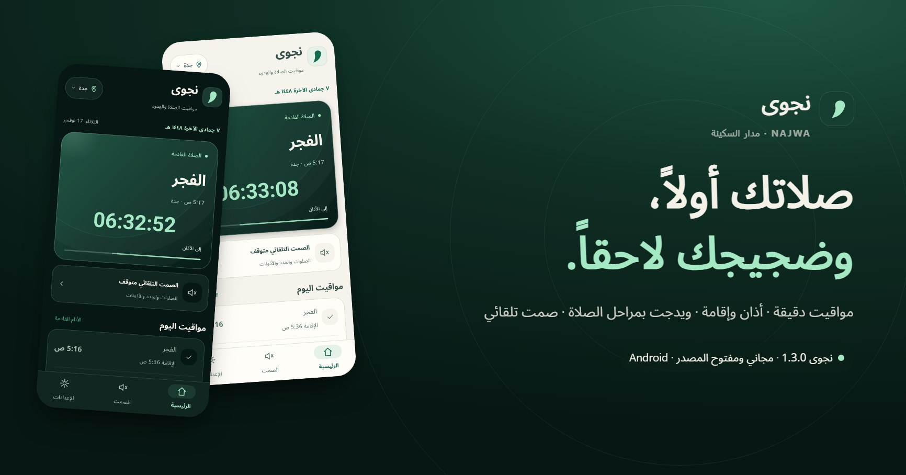
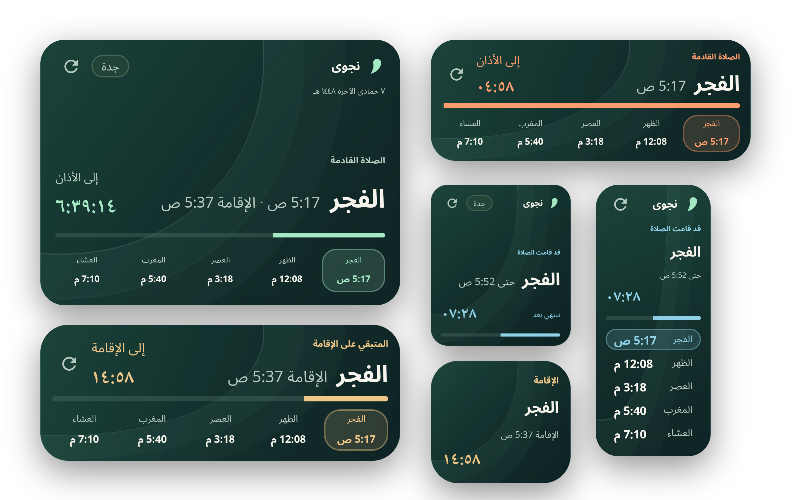
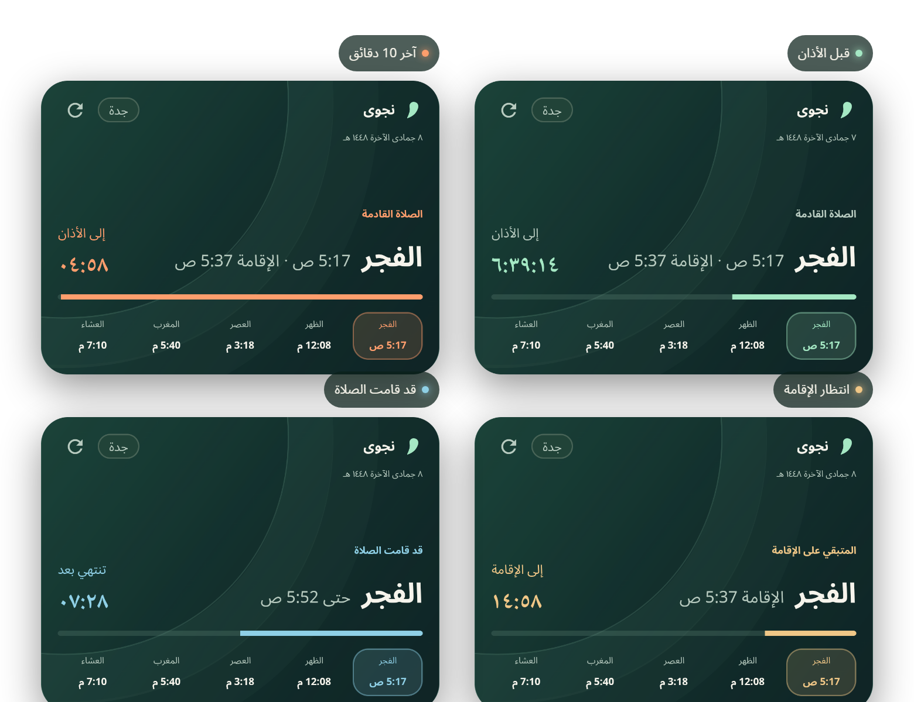
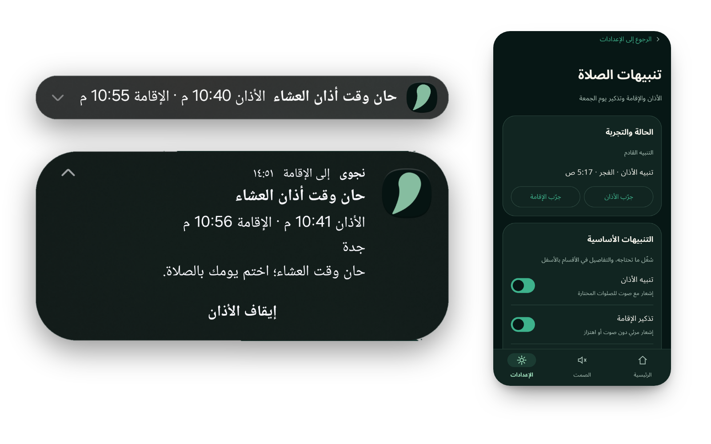

<div align="center">


# نجوى · Najwa

**صلاتك أولاً، وضجيجك لاحقاً.**  
**Prayer first. Noise can wait.**

مواقيت دقيقة، وأذان وإقامة بتنبيهات أنيقة، وويدجت يعيش معك مراحل الصلاة، وصمت تلقائي يعيد رنينك بعد الصلاة.  
Accurate prayer times, refined adhan and iqama alerts, a widget that follows every stage of prayer, and auto‑silence that gives your ringer back afterwards.

<a href="https://github.com/taroq4-2/Najwa/releases/latest/download/Najwa.apk"></a>

[الموقع العربي](https://taroq4-2.github.io/Najwa/) · [English website](https://taroq4-2.github.io/Najwa/en.html) · [الإصدارات · Releases](https://github.com/taroq4-2/Najwa/releases)

    [](https://github.com/taroq4-2/Najwa/actions/workflows/android.yml) [](LICENSE)



</div>

## ما الجديد في 1.3.0 · What's new

<div dir="rtl">

- **ويدجت بمراحل الصلاة:** قبل الأذان بالأخضر، ويتحوّل إلى لون تنبيه في آخر 10 دقائق، ثم «المتبقي على الإقامة» بالذهبي، ثم **«قد قامت الصلاة»** حتى نهاية مدة الصلاة التي حددتها، مع مواقيت اليوم الخمس في كل المقاسات المناسبة.
- **إشعار أصلي كامل:** يملأ بطاقة الإشعار ويتبع سمة هاتفك، مع عدّاد حيّ إلى الإقامة وزر **«إيقاف الأذان»** الذي يوقف الصوت ويُبقي العدّاد.
- **إعداد أول في أربع خطوات:** المدينة وطريقة الحساب، ثم ما تريده من نجوى، ثم الأذونات اللازمة فقط، ثم ملخص جاهز مع «تخصيص متقدم».
- **إعدادات أسهل:** «الإعدادات السريعة» في الأعلى، وصفحة التنبيهات بأقسام قابلة للطي، وزرّا تجربة للأذان والإقامة، دون إزالة أي خيار.

</div>

- **Stage‑aware widget:** green before adhan, an alert colour in the last 10 minutes, gold “time to iqama”, then **“The prayer has begun”** until your prayer window ends, plus today's five times in every roomy size.
- **Complete native notification:** fills the card and follows your phone theme, with a live iqama countdown and a **Stop adhan** button that silences the sound and keeps the countdown.
- **Four‑step first run:** city and method, the features you want, only the permissions they need, and a summary with *Advanced customization*.
- **Easier settings:** Quick settings at the top, collapsible alert sections and test buttons for adhan and iqama — every existing option is still there.

## معاينة التطبيق · App preview

| الرئيسية الداكنة · Dark | الرئيسية الفاتحة · Light | English | الإعدادات السريعة · Quick settings |
| :---: | :---: | :---: | :---: |
|  |  |  |  |

### الويدجت · Widgets

<div dir="rtl">

سبعة مقاسات بلغة تصميم واحدة. كل مقاس يسمّي المرحلة الحالية، ويعرض العدّاد وشريطًا يمتلئ كلما اقتربت الصلاة، والمقاسات الأوسع تعرض مواقيت اليوم مع إبراز الصلاة القادمة.

</div>

Seven sizes, one design language. Every size names the current stage, shows the countdown and a bar that fills as the prayer approaches; roomier sizes list the day's five prayers with the next one highlighted.



| <div dir="rtl">مراحل الصلاة في الويدجت</div> | The four widget stages |
| :---: | :---: |
|  |  |

### الأذان والإقامة · Adhan & iqama

<div dir="rtl">

إشعار أصلي يظهر كاملًا: عنوان الصلاة، وموعدا الأذان والإقامة، والمدينة، ورسالة الصلاة، وعدّاد حيّ إلى الإقامة، وزر «إيقاف الأذان». ويمكنك تجربة الإشعار من صفحة التنبيهات.

</div>

A native, complete notification: the prayer, adhan and iqama times, your city, a short message, a live countdown to iqama and a *Stop adhan* button. Try it any time from the alerts page.



### بداية سهلة · Easy first run


## المزايا · Features

| <div dir="rtl">الميزة</div> | Feature |
| :--- | :--- |
| <div dir="rtl">حساب المواقيت على جهازك دون إنترنت، مع 5 طرق حساب وزوايا مخصصة، وحساب العصر الحنفي وخطوط العرض العالية</div> | Offline calculation with 5 methods plus custom angles, Hanafi Asr and high‑latitude rules |
| <div dir="rtl">أكثر من 459 ألف مكان في 246 دولة وإقليم، أو موقع مخصص بالإحداثيات</div> | 459,000+ places in 246 countries and territories, or custom coordinates |
| <div dir="rtl">تنبيه أذان بالصوت الذي تختاره من ملفاتك، وتذكير إقامة صامت، وتذكير الجمعة</div> | Adhan with your own sound file, silent iqama reminder, Friday reminder |
| <div dir="rtl">اختيار الصلوات لكل تنبيه، ومدة الإقامة والصمت لكل صلاة</div> | Per‑prayer selection, iqama and silence durations for each prayer |
| <div dir="rtl">صمت تلقائي بعد الأذان بـ20 ثانية واستعادة وضع الرنين السابق بأمان</div> | Auto‑silence 20 s after adhan, safely restoring your previous ringer |
| <div dir="rtl">مظهر فاتح وداكن، و7 لغات: العربية والإنجليزية والإندونيسية والأردية والبنغالية والهندية والتركية</div> | Light and dark themes; 7 languages: Arabic, English, Indonesian, Urdu, Bengali, Hindi, Turkish |
| <div dir="rtl">بلا إعلانات ولا حسابات ولا تتبّع؛ بياناتك تبقى على جهازك</div> | No ads, no accounts, no tracking — your data stays on your device |

## التثبيت · Install

<div dir="rtl">

1. نزّل [Najwa.apk](https://github.com/taroq4-2/Najwa/releases/latest/download/Najwa.apk) وافتحه، واسمح بالتثبيت من مصدر التنزيل إذا طلب Android ذلك.
2. اتبع خطوات الإعداد الأربع: المدينة، والميزات، والأذونات، ثم ابدأ.
3. أضف الويدجت من «الإعدادات ← ويدجت الشاشة الرئيسية».

الملف موقّع بالمفتاح الرسمي نفسه، فيُحدَّث فوق الإصدار السابق مع الحفاظ على إعداداتك.

</div>

1. Download [Najwa.apk](https://github.com/taroq4-2/Najwa/releases/latest/download/Najwa.apk), open it and allow installs from your browser if Android asks.
2. Follow the four setup steps: city, features, permissions, start.
3. Add the widget from *Settings → Home screen widget*.

The APK is signed with the same official key, so it updates the previous version and keeps your settings.

## الإصدار والتحقق · Release verification

**1.3.0 · Build 114** — SHA-256 · `Najwa.apk`:

```text
9b9b88b59a71154b9a549ab389bc5c2556b98346c523f776065c821600ffd2ab
```

<div dir="rtl">

نجح 182 اختبارًا محليًا (الحساب، والجدولة، والإشعارات، والويدجت في كل المقاسات والمراحل) وفحص الخصوصية وlint الإصدار، وجُرّبت الواجهات والإشعارات على Samsung Galaxy S23 Ultra بنظام Android 17. [تفاصيل الإصدار](https://github.com/taroq4-2/Najwa/releases/tag/v1.3.0).

</div>

All 182 local tests (calculation, scheduling, notifications, widgets in every size and stage), the privacy audit and release lint passed; screens and notifications were exercised on a Samsung Galaxy S23 Ultra running Android 17. See [release verification](docs/release-verification.md).

## البناء والمساهمة · Build and contribute

<div dir="rtl">

استخدم JDK 21 وAndroid SDK 36. الشفرة متاحة للتعديل وفق [Apache 2.0](LICENSE). لاقتراح تحسين أو الإبلاغ عن مشكلة [افتح Issue](https://github.com/taroq4-2/Najwa/issues).

</div>

Use JDK 21 and Android SDK 36. On Windows use `gradlew.bat` with the same arguments.

```sh
./gradlew -PplatformTests=true :core:test :app:testDebugUnitTest :app:assembleDebug :app:lintRelease
```

[Release verification](docs/release-verification.md) · [Third‑party notices](app/src/main/assets/licenses/THIRD_PARTY_NOTICES.md) · [Open an issue](https://github.com/taroq4-2/Najwa/issues)

<div align="center">

[os73.com](https://os73.com/) · [contact@os73.com](mailto:contact@os73.com)

اللهم ارحم ابي

</div>
