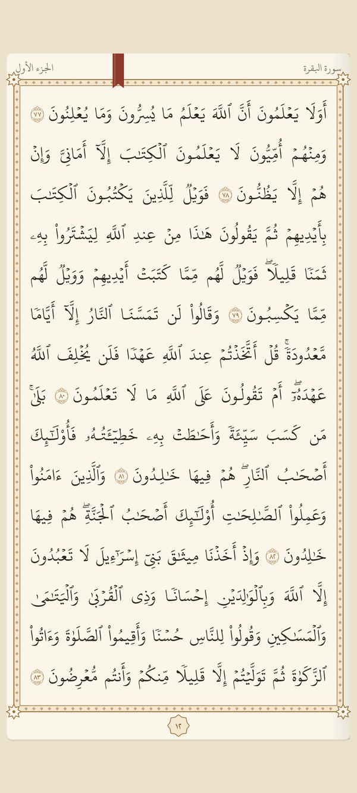
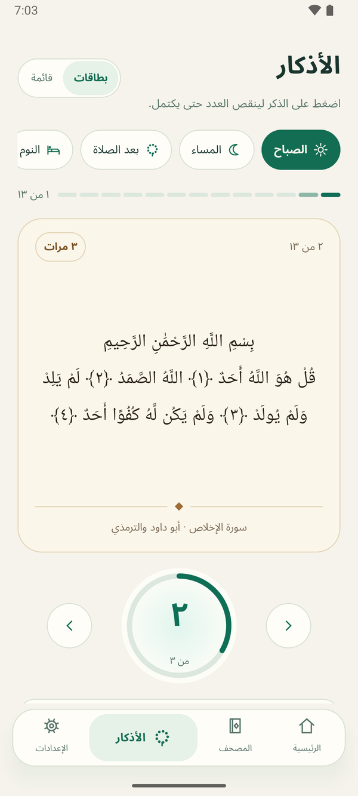
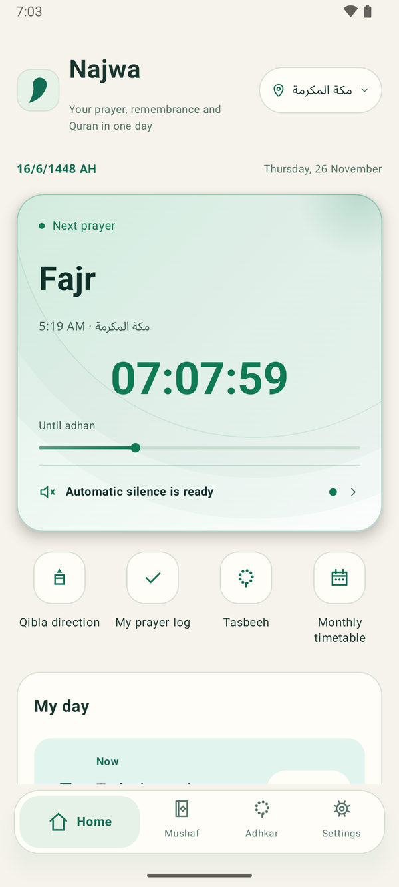
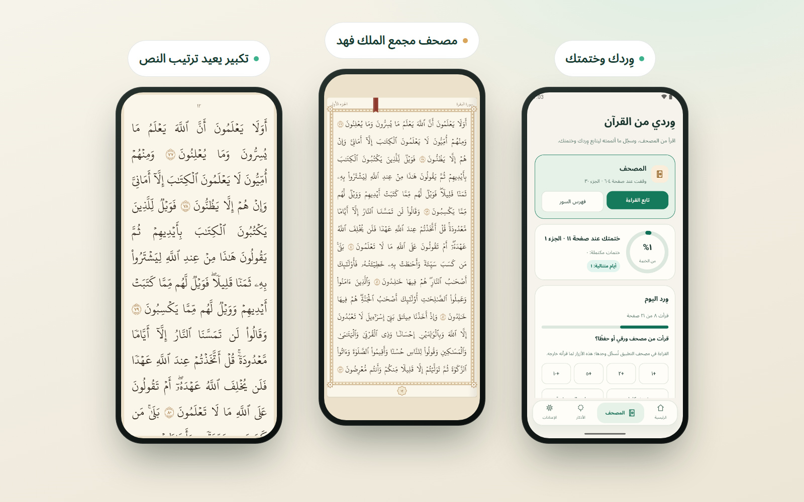
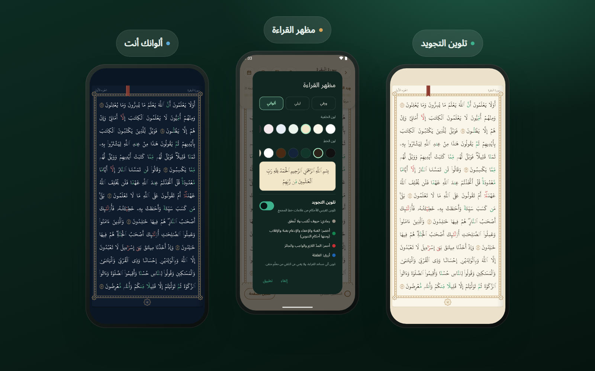
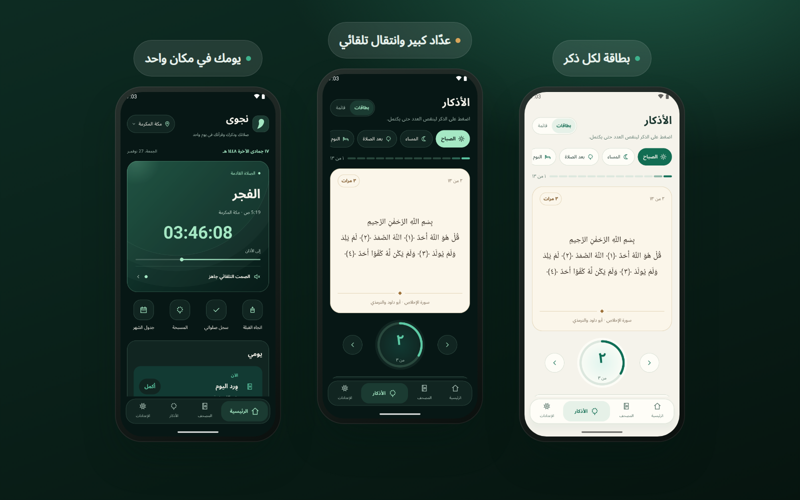
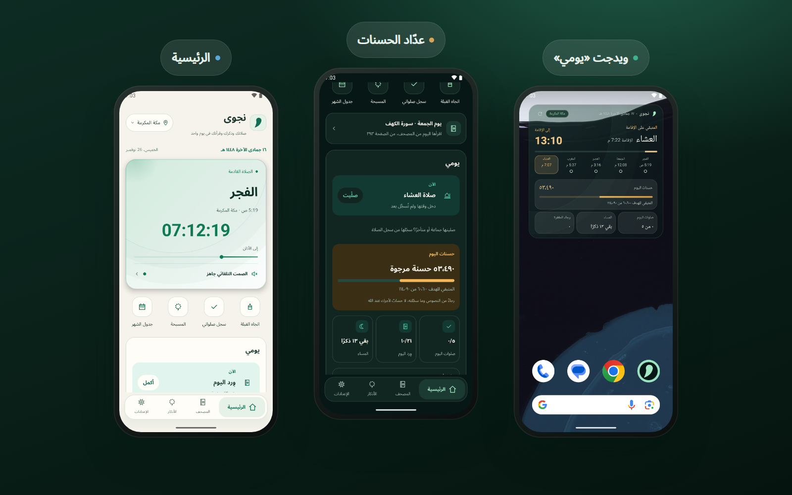
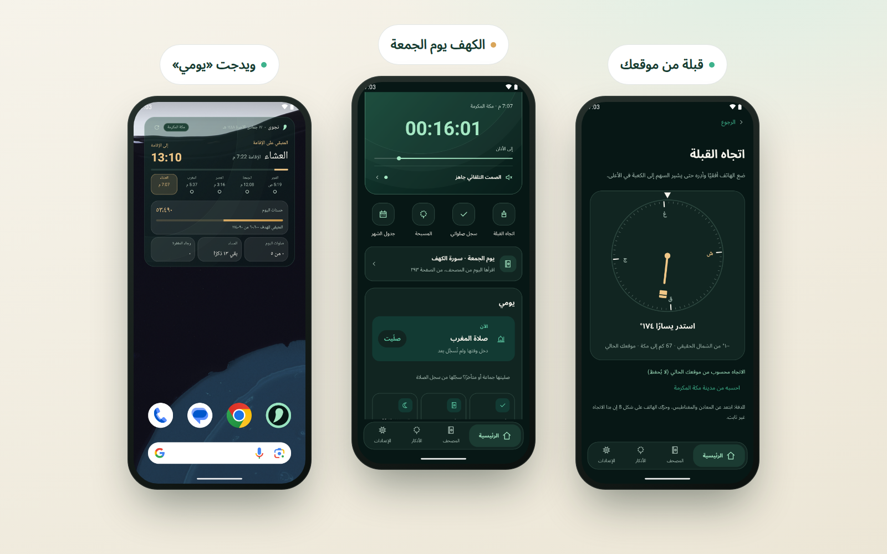
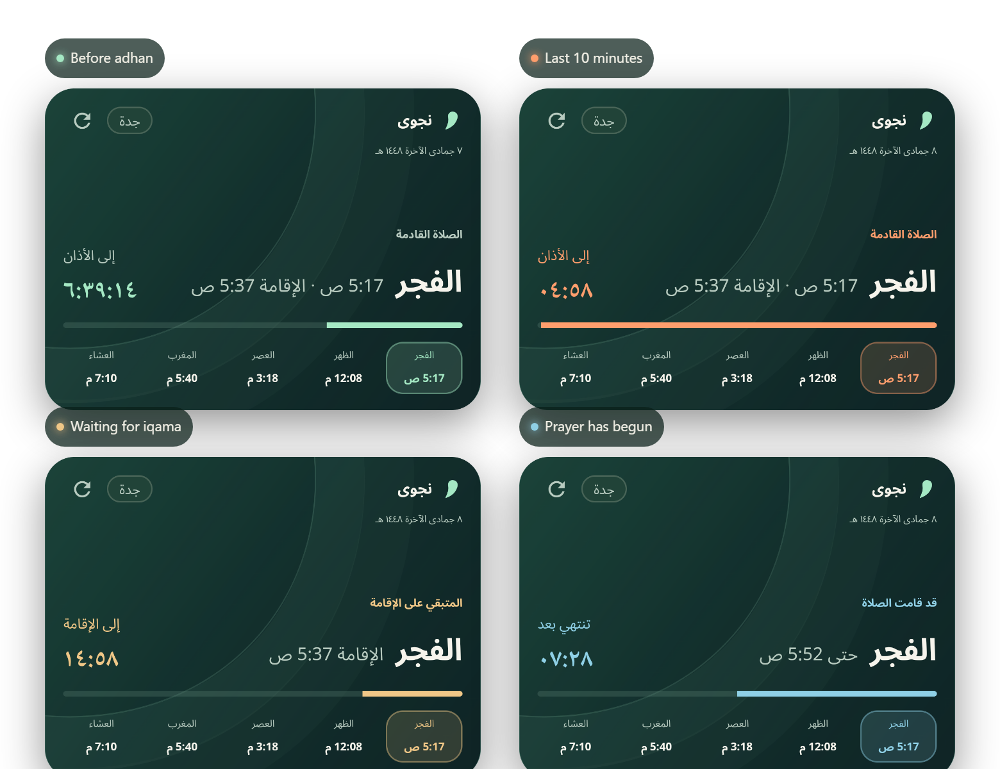

<div align="center">


# نجوى · Najwa

**صلاتك وذكرك وقرآنك، في يوم واحد.**  
**Your prayer, remembrance and Quran — in one calm day.**

مواقيت دقيقة وأذان وإقامة، ومصحف بخط مجمع الملك فهد يكبر نصه ويُعاد ترتيبه، وأذكار ببطاقات وعدّاد، وصمت تلقائي يعيد رنينك، وويدجت «يومي» على شاشتك.  
Accurate prayer times with adhan and iqama, a King Fahd Complex mushaf whose text grows and reflows, adhkar on cards with a counter, auto‑silence that gives your ringer back, and a “My day” widget on your home screen.

<a href="https://github.com/taroq4-2/Najwa/releases/latest/download/Najwa.apk"></a>
<a href="https://apps.obtainium.imranr.dev/redirect?r=obtainium://add/https://github.com/taroq4-2/Najwa"></a>

[الموقع العربي](https://taroq4-2.github.io/Najwa/) · [English website](https://taroq4-2.github.io/Najwa/en.html) · [الإصدارات · Releases](https://github.com/taroq4-2/Najwa/releases)

    [](https://github.com/taroq4-2/Najwa/actions/workflows/android.yml) [](LICENSE)


</div>

## ما الجديد في 1.7.1 · What's new

<div dir="rtl">

- **عدّاد الحسنات مفعّل:** اعتمد مختص شرعي القواعد السبع عشرة كما هي، فصار الإصدار الرسمي يعرض الحسنات المرجوّة اليوم والمتبقي للهدف وأعمال رجاء المغفرة والفضائل بأدلتها، في «يومي» والويدجت والمصحف. [ملاحظات 1.7.1](docs/releases/1.7.1.md).

</div>

- **The hasanat counter is on:** a qualified scholar approved all 17 rules as written, so the official build shows today's hoped-for hasanat, what is left to your goal, actions hoped to expiate sins and the virtues with their evidence, on "My day", the widget and the mushaf. [1.7.1 notes](docs/releases/1.7.1.md).

### وفي 1.7.0 · Also in 1.7.0

<div dir="rtl">

يجمع هذا الإصدار كل ما بعد 1.3.0 (الإصدارات 1.4 إلى 1.7).

- **مصحف مجمع الملك فهد:** نص المصحف وخطه من مجمع الملك فهد لطباعة المصحف الشريف (رواية حفص)، في صفحات مطابقة لمصحف المدينة النبوية بخمسة عشر سطرًا متساوية. التكبير بإصبعين أو بلمستين يكبّر **النص نفسه** ويعيد ترتيبه، وليس صورة. يحفظ موضعك تلقائيًا، ويتابع ختمتك ووِردك اليومي، مع علامات وتظليل وبحث.
- **أذكار بطريقة جديدة:** بطاقة لكل ذكر تقلّبها كالصفحات، بخط نسخ واضح (والآيات بخط المجمع)، وعدّاد دائري كبير؛ تلمس البطاقة أو العدّاد فيُحسب، وينتقل وحده إلى الذكر التالي. وتبقى طريقة القائمة لمن يفضّلها.
- **ويدجت «يومي»:** بطاقة واحدة فيها الصلاة القادمة وعدّادها، ومواقيت اليوم مع علامة تحت كل صلاة سجّلتها، ثم صلواتك وأذكار الوقت ووِردك، مع **شفافية للخلفية من 0 إلى 100%**.
- **تنقّل جديد:** شريط سفلي عائم بأربعة تبويبات: الرئيسية، والمصحف، والأذكار، والإعدادات. وانتقل «الصمت» إلى الإعدادات.
- **رئيسية مرتّبة:** حالة الصمت داخل بطاقة العدّاد، والأدوات صفًّا واحدًا، وشريط يمتلئ من اليمين إلى اليسار كلما اقتربت الصلاة.
- **تلوين التجويد ومظهر بألوانك:** تلوين تقريبي للأحكام من علامات خط المجمع (اختياري، مع دليل)، واختيار لون الخلفية والخط في القراءة.
- **قبلة أدق:** احسب الاتجاه من موقعك الحالي بلمسة بدل مركز المدينة (لا يُحفظ)، مع حروف الجهات وتنبيه التداخل المغناطيسي.
- **إعدادات أوضح:** قسما «الصمت أثناء الصلاة» و«الويدجت»، وحالة صادقة حين تكون التنبيهات متوقفة، وأرقام تتبع اختيارك في كل مكان.
- **ومنذ 1.3.0 أيضًا:** سجل صلوات بالجماعة والسنن وخريطة الأسابيع، وويدجت «صلواتي اليوم»، ومسبحة حيّة بتسبيح ما بعد الصلاة، وأذكار النوم والاستيقاظ والمسجد، وخطة ختمة، ودعاء اليوم. [كل التفاصيل](docs/releases/1.7.0.md).

</div>

This release brings together everything since 1.3.0 (versions 1.4 to 1.7).

- **King Fahd Complex mushaf:** the Quran text and script of the King Fahd Glorious Quran Printing Complex (Hafs), on pages that match the Madinah mushaf with fifteen even lines. Pinch or double‑tap enlarges **the text itself**, which reflows — not a picture. Your place is saved automatically, with your khatma, daily portion, bookmarks, highlights and search.
- **Adhkar, reimagined:** one card per dhikr, turned like pages, in a clear naskh (Quranic passages in the Complex's font), with a large ring counter. Tap the card or the counter to count; it moves on to the next dhikr by itself. The list view stays for those who prefer it.
- **“My day” widget:** one card with the next prayer and its countdown, today's times with a mark under each prayer you recorded, then your prayers, the adhkar of the moment and your portion — with **background transparency from 0 to 100%**.
- **New navigation:** a floating bottom bar with four tabs — Home, Mushaf, Adhkar, Settings. Silence now lives in Settings.
- **A tidier home:** silence status inside the countdown card, tools in one row, and a bar that fills from right to left as the prayer approaches.
- **Tajweed colours and your own reading colours:** optional approximate rule colouring from the Complex's own marks, with a legend, and your choice of background and text colours.
- **A more precise Qibla:** one tap works the direction out from where you stand instead of the city centre (never saved), with cardinal points and a magnetic interference warning.
- **Clearer settings:** *Silence during prayer* and *Widgets* sections, an honest status when alerts are off, and digits that follow your choice everywhere.
- **Also since 1.3.0:** a prayer log with congregation and sunnah prayers and a weekly map, the *Today's prayers* widget, a living tasbeeh with the after‑prayer sequence, sleep, waking and mosque adhkar, a khatma plan and the dua of the day. [Full notes](docs/releases/1.7.0.md).

> **عن «الحسنات المرجوّة» · About “hoped‑for hasanat”** — <span dir="rtl">قواعد العدّاد السبع عشرة **اعتمدها مختص شرعي كما هي** (27 نوفمبر 2026، والاسم محفوظ لدى المطوّر؛ [سجل الاعتماد](docs/worship/EVIDENCE.md)). تُحسب الحسنات على هاتفك من الأعمال التي تسجّلها فقط: كل حرف من المصحف بعشر، والأذكار التي ورد فيها عدد، دون مضاعِف عام. وما يُعرض رجاءٌ مستند إلى النصوص، لا حسابٌ لأجرك عند الله.</span>  
> The counter's 17 rules were **approved as written by a qualified scholar** (27 November 2026; the name is kept by the developer; [approval log](docs/worship/EVIDENCE.md)). Hasanat are worked out on your phone only from what you record — ten per letter read from the mushaf, and adhkar whose number is narrated — with no general multiplier. Figures are a hope based on the texts, not a measure of anyone's reward with Allah.

## معاينة التطبيق · App preview

| الرئيسية · Home | المصحف · Mushaf | الأذكار · Adhkar | English |
| :---: | :---: | :---: | :---: |
|  |  |  |  |

### المصحف · The mushaf

<div dir="rtl">

صفحات مطابقة لمصحف المدينة النبوية، وعلامات الآيات من خط المجمع نفسه. كبّر بإصبعين أو بلمستين فيكبر النص ويتدفّق، وارجع إلى الصفحة المطبوعة بلمستين.

</div>

Pages that match the Madinah mushaf, with verse ornaments from the Complex's own font. Pinch or double‑tap and the text grows and flows; double‑tap again for the printed page.



### تلوين التجويد ومظهر القراءة · Tajweed colours and reading appearance

<div dir="rtl">

تلوين تقريبي للأحكام من علامات خط المجمع، مع دليل للألوان، واختيار الورقي أو الليلي أو ألوانك أنت للخلفية والخط.

</div>

Approximate rule colouring from the Complex's own marks, with a legend, and paper, night or your own background and text colours.



### الأذكار · Adhkar



### يومك وويدجت «يومي» · Your day and the “My day” widget



### القبلة والكهف وويدجت «يومي» · Qibla, Al-Kahf and the “My day” widget



### مراحل الصلاة في الويدجت · Widget stages

| <div dir="rtl">مراحل الصلاة في الويدجت</div> | The four widget stages |
| :---: | :---: |
|  |  |

### الأذان والإقامة · Adhan & iqama


## المزايا · Features

| <div dir="rtl">الميزة</div> | Feature |
| :--- | :--- |
| <div dir="rtl">حساب المواقيت على جهازك دون إنترنت، مع 12 طريقة حساب وزوايا مخصصة، وتعديل بالدقائق لكل صلاة، والعصر الحنفي وخطوط العرض العالية</div> | Offline calculation with 12 methods plus custom angles, per‑prayer minute adjustments, Hanafi Asr and high‑latitude rules |
| <div dir="rtl">أكثر من 459 ألف مكان في 246 دولة وإقليم، أو موقع مخصص بالإحداثيات</div> | 459,000+ places in 246 countries and territories, or custom coordinates |
| <div dir="rtl">أذانان مدمجان أو ملفك الخاص، وأذان مستقل للفجر، وتذكير الإقامة وقبل الأذان والجمعة، وعدّاد الإقامة الحي على شاشة القفل</div> | Two built‑in adhans or your own file, a separate Fajr adhan, iqama, pre‑adhan and Friday reminders, and a live iqama countdown on the lock screen |
| <div dir="rtl">مصحف مجمع الملك فهد (حفص) بصفحات مطابقة، وتكبير يعيد ترتيب النص، وحفظ تلقائي للموضع، وختمة ووِرد يومي، وعلامات وتظليل وبحث</div> | King Fahd Complex mushaf (Hafs) with matching pages, reflowing zoom, automatic bookmark, khatma and daily portion, bookmarks, highlights and search |
| <div dir="rtl">أذكار الصباح والمساء وبعد الصلاة والنوم والاستيقاظ والمسجد من «حصن المسلم»، ببطاقات وعدّاد أو بقائمة</div> | Morning, evening, after‑prayer, sleep, waking and mosque adhkar from *Hisn al‑Muslim*, as cards with a counter or as a list |
| <div dir="rtl">عدّاد الحسنات المرجوّة والمتبقي للهدف بقواعد اعتمدها مختص شرعي، في «يومي» والويدجت والمصحف</div> | A hoped‑for hasanat counter and what is left to your goal, with scholar‑approved rules, on “My day”, the widget and the mushaf |
| <div dir="rtl">سجل صلوات خاص بك مع الجماعة والسنن والقضاء وخريطة الأسابيع، ومسبحة بتسبيح ما بعد الصلاة</div> | A private prayer log with congregation, sunnah, qada and a weekly map, and a tasbeeh with the after‑prayer sequence |
| <div dir="rtl">ويدجت «يومي» وسبعة مقاسات لويدجت الصلاة، وويدجت للمصحف وللسجل وللمسبحة، بشفافية تختارها</div> | The “My day” widget, a prayer widget in seven sizes, and mushaf, log and tasbeeh widgets, with the transparency you choose |
| <div dir="rtl">صمت تلقائي أثناء الصلاة يعيد الرنين بعدها، و«صمت نجوى» من الإعدادات السريعة</div> | Auto‑silence during prayer that restores your ringer, plus “Silence now” in Quick Settings |
| <div dir="rtl">مساجد بأوقات إقامة تُشارك برمز QR، وبوصلة القبلة، والتاريخ الهجري مع التصحيح، ووضع رمضان، وجدول شهري للطباعة</div> | Mosques with iqama times shared by QR code, Qibla compass, Hijri date with correction, Ramadan mode and a printable month |
| <div dir="rtl">مظهر فاتح وداكن وألوان قراءة هادئة، و7 لغات: العربية والإنجليزية والإندونيسية والأردية والبنغالية والهندية والتركية</div> | Light and dark themes with calm reading colours; 7 languages: Arabic, English, Indonesian, Urdu, Bengali, Hindi, Turkish |

## الخصوصية والشفافية · Privacy and transparency

<div dir="rtl">

**لا يطلب نجوى إذن الإنترنت أصلًا**، فلا يستطيع إرسال أي شيء إلى أي خادم. لا حسابات ولا إعلانات ولا أدوات تحليل أو تتبع، والنسخ الاحتياطي التلقائي لنظام Android معطّل. كل ما يلي يبقى على هاتفك فقط: الإعدادات، وسجل تقني محدود لاستعادة الرنين، وعبادتك إن استخدمتها (الصلوات والقضاء، والقراءة والختمة والعلامات، وتقدّم الأذكار والمسبحة)، ونسخة خاصة من صوت الأذان إن اخترته من ملفاتك.

ما يخرج من هاتفك يخرج **بقرارك فقط**: ملف النسخة الاحتياطية الذي تحفظه حيث تشاء (ويمكن حمايته بكلمة مرور وتشفير AES‑256‑GCM)، وما تشاركه بنفسك، ورسالة البريد التي تراجعها وترسلها، و«ربط التطبيقات» إن فعّلته (متوقف افتراضيًا) ليبث مراحل الصلاة لتطبيقات الأتمتة على هاتفك. سياسة الخصوصية الكاملة داخل التطبيق: الإعدادات ← معلومات التطبيق ← سياسة الخصوصية.

</div>

**Najwa does not request the internet permission at all**, so it cannot send anything to any server. No accounts, ads, analytics or tracking; Android's automatic backup is turned off. Settings, a small technical log for restoring the ringer, your worship records if you use them, and a private copy of an adhan you pick all stay on your phone. Anything that leaves it does so **only by your choice**: a backup file you save (optionally password‑protected with AES‑256‑GCM), what you share, an email you review and send, and *App linking* if you turn it on (off by default), which broadcasts prayer stages to automation apps on your phone. The full policy is in the app: *Settings → App information → Privacy policy*.

### الأذونات ولماذا · Permissions and why

| <div dir="rtl">الإذن</div> · Permission | <div dir="rtl">لماذا</div> | Why |
| :--- | :--- | :--- |
| `POST_NOTIFICATIONS` | <div dir="rtl">إظهار الأذان والإقامة والتذكيرات</div> | Show adhan, iqama and reminders |
| `POST_PROMOTED_NOTIFICATIONS` | <div dir="rtl">عدّ الإقامة الحي في شريط الحالة على Android 16</div> | Live iqama countdown in the status bar on Android 16 |
| `SCHEDULE_EXACT_ALARM` | <div dir="rtl">أن يأتي الأذان والصمت في وقتهما تمامًا</div> | Adhan and silence exactly on time |
| `ACCESS_NOTIFICATION_POLICY`, `MODIFY_AUDIO_SETTINGS` | <div dir="rtl">تصميت الهاتف وقت الصلاة ثم إعادته كما كان</div> | Silence the phone during prayer and restore it as it was |
| `RECEIVE_BOOT_COMPLETED` | <div dir="rtl">إعادة جدولة التنبيهات بعد إعادة تشغيل الهاتف</div> | Reschedule alerts after a restart |
| `FOREGROUND_SERVICE`, `…_SPECIAL_USE`, `…_MEDIA_PLAYBACK` | <div dir="rtl">تشغيل صوت الأذان وإبقاء الصمت حتى نهايته</div> | Play the adhan and keep silence until it ends |
| `VIBRATE` | <div dir="rtl">الاهتزاز مع التنبيهات وعند عدّ الأذكار</div> | Vibrate with alerts and when counting adhkar |
| `ACCESS_COARSE_LOCATION` | <div dir="rtl">مرة واحدة فقط حين تضغط «تحديد مدينتي» أو «اتجاه أدق من موقعي» في صفحة القبلة؛ لا يُحفظ إلا المدينة</div> | Only once, when you tap *Find my city* or *use my current location* on the Qibla page; only the city is kept |

<div dir="rtl">أُضيفت منذ 1.3.0 أربعة أذونات فقط: الموقع التقريبي، وخدمة تشغيل الوسائط، والإشعارات المميزة، والاهتزاز؛ ولم يُضف أي إذن في 1.7. ولا يطلب نجوى: الإنترنت، ولا جهات الاتصال، ولا الصور أو الملفات العامة، ولا الميكروفون أو الكاميرا، ولا الموقع في الخلفية.</div>

Since 1.3.0 only four permissions were added — approximate location, media‑playback service, promoted notifications and vibration — and none in 1.7. Najwa does not ask for: internet, contacts, photos or general file access, microphone or camera, or background location.

## المصادر والحقوق · Sources and credits

<div dir="rtl">

- **نص المصحف وخطه:** مجمع الملك فهد لطباعة المصحف الشريف بالمدينة المنورة (خط حفص KFGQPC ونصه). جميع الحقوق محفوظة للمجمع، ويُستخدمان في نجوى بإذنه.
- **الأذكار:** «حصن المسلم» للشيخ سعيد بن علي بن وهف القحطاني رحمه الله، مع مصادرها من كتب الحديث.
- **بيانات السور والأجزاء:** مشروع تنزيل. **دليل المدن:** GeoNames بترخيص CC BY 4.0. **خط الواجهة:** Noto Sans Arabic بترخيص SIL OFL. **المكوّنات:** AndroidX وKotlin بترخيص Apache‑2.0.
- المواقيت حسابية؛ راجعها مع تقويم بلدك ومسجدك. أوقات الإقامة تذكير تضبطه أنت، وليست مواعيد معتمدة للمساجد.

</div>

- **Quran text and script:** King Fahd Glorious Quran Printing Complex, Madinah (KFGQPC Hafs font and text). All rights reserved by the Complex; used in Najwa with its permission.
- **Adhkar:** *Hisn al‑Muslim* by Shaykh Sa'id ibn Ali ibn Wahf al‑Qahtani, with their hadith sources.
- **Surah and juz data:** the Tanzil project. **Cities:** GeoNames, CC BY 4.0. **Interface font:** Noto Sans Arabic, SIL OFL. **Components:** AndroidX and Kotlin, Apache‑2.0. Full texts: [third‑party notices](app/src/main/assets/licenses/THIRD_PARTY_NOTICES.md).
- Times are calculated; check them against your local calendar and mosque. Iqama times are reminders you set, not official mosque times.

## التثبيت · Install

<div dir="rtl">

1. نزّل [Najwa.apk](https://github.com/taroq4-2/Najwa/releases/latest/download/Najwa.apk) وافتحه، واسمح بالتثبيت من مصدر التنزيل إذا طلب Android ذلك.
2. اتبع خطوات الإعداد: المدينة، والميزات، والأذونات، ثم ابدأ.
3. أضف ويدجت «يومي» من «الإعدادات ← الويدجت».

الملف موقّع بالمفتاح الرسمي نفسه، فيُحدَّث فوق الإصدار السابق مع الحفاظ على إعداداتك. وللتحديث التلقائي دون متجر: ثبّت [Obtainium](https://github.com/ImranR98/Obtainium) وأضف `https://github.com/taroq4-2/Najwa`.

</div>

1. Download [Najwa.apk](https://github.com/taroq4-2/Najwa/releases/latest/download/Najwa.apk), open it and allow installs from your browser if Android asks.
2. Follow the setup: city, features, permissions, start.
3. Add the “My day” widget from *Settings → Widgets*.

The APK is signed with the same official key, so it updates the previous version and keeps your settings. For automatic updates without a store, install [Obtainium](https://github.com/ImranR98/Obtainium) and add `https://github.com/taroq4-2/Najwa`.

## الإصدار والتحقق · Release verification

**1.7.1 · Build 119** — SHA-256 · `Najwa.apk`:

```text
{{SHA256}}
```

<div dir="rtl">

نجح 329 اختبارًا (148 لحساب المواقيت والجدولة والمنطق والحسنات، و181 على منصة Android للمصحف والأذكار والويدجت والسجل)، وفحص الخصوصية، وlint الإصدار. وجُرّبت الشاشات والويدجت على محاكي Android، والصفحات 1 و12 و604 مقابل مصحف المدينة المطبوع. [تفاصيل الإصدار](https://github.com/taroq4-2/Najwa/releases/tag/v1.7.1).

</div>

All 329 tests passed (148 core tests for calculation, scheduling, logic and hasanat; 181 Android platform tests for the mushaf, adhkar, widgets and log), along with the privacy audit and release lint. Screens and widgets were exercised on an Android emulator, and pages 1, 12 and 604 were compared with the printed Madinah mushaf. [Release notes](https://github.com/taroq4-2/Najwa/releases/tag/v1.7.1).

## البناء والمساهمة · Build and contribute

<div dir="rtl">

استخدم JDK 21 وAndroid SDK 36. الشفرة متاحة للتعديل وفق [Apache 2.0](LICENSE) (أما نص المصحف وخطه فحقوقهما لمجمع الملك فهد). لاقتراح تحسين أو الإبلاغ عن مشكلة [افتح Issue](https://github.com/taroq4-2/Najwa/issues).

</div>

Use JDK 21 and Android SDK 36. The code is Apache 2.0 (the Quran text and font remain the Complex's). On Windows use `gradlew.bat` with the same arguments.

```sh
./gradlew -PplatformTests=true :core:test :app:testDebugUnitTest :app:assembleDebug :app:lintRelease
```

[Release verification](docs/release-verification.md) · [Third‑party notices](app/src/main/assets/licenses/THIRD_PARTY_NOTICES.md) · [Open an issue](https://github.com/taroq4-2/Najwa/issues)

<div align="center">

[os73.com](https://os73.com/) · [contact@os73.com](mailto:contact@os73.com)

اللهم ارحم ابي

</div>
