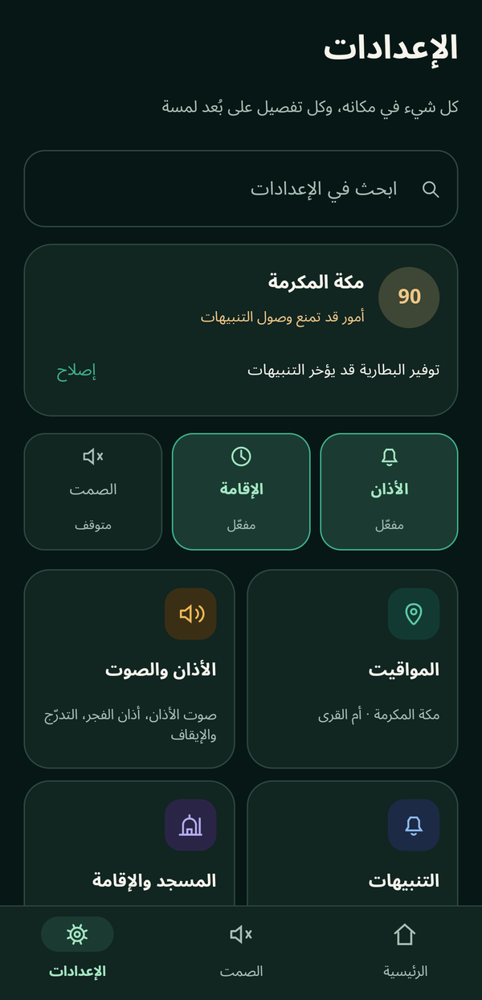
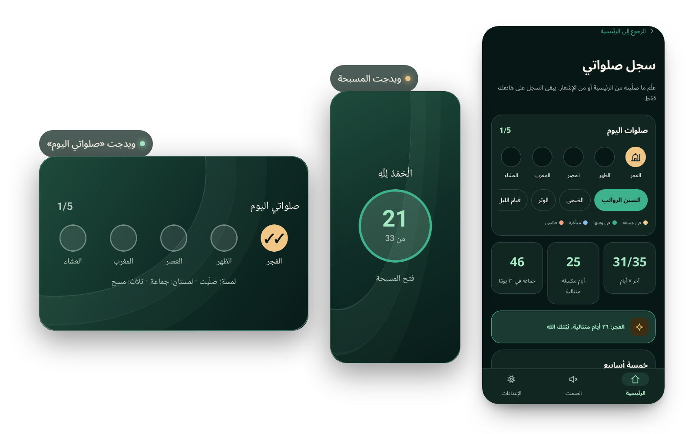
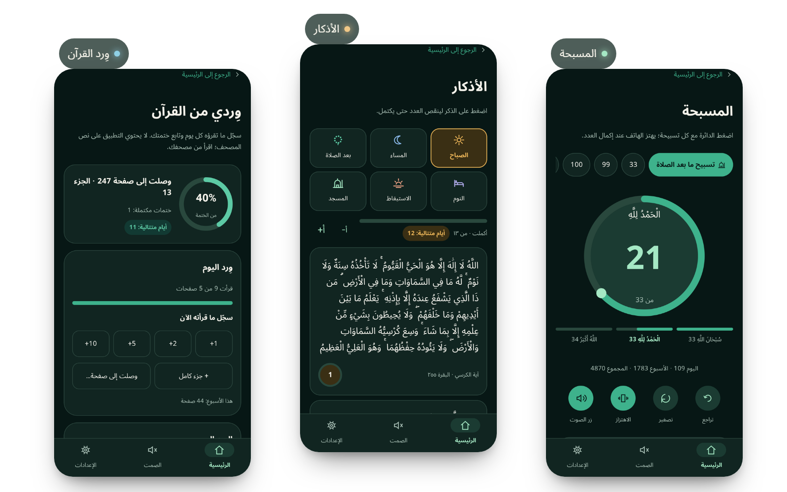
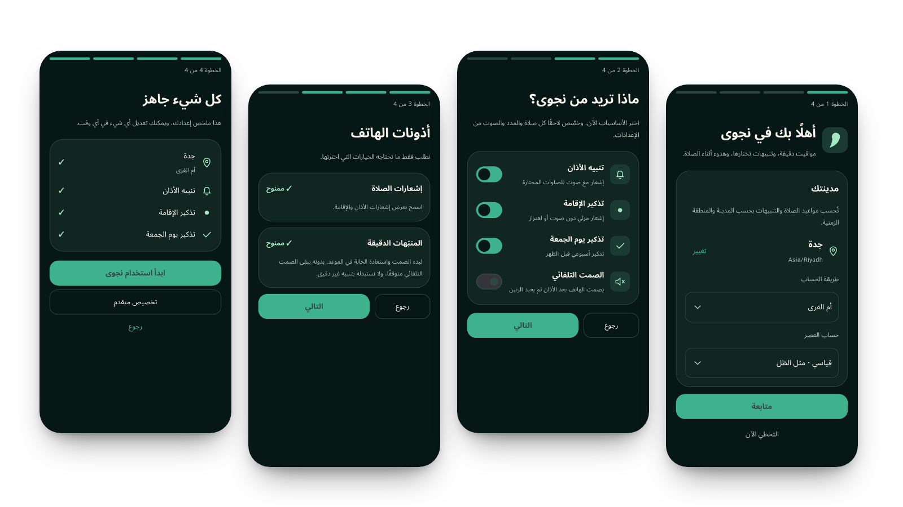

<div align="center">


# نجوى · Najwa

**صلاتك أولاً، وضجيجك لاحقاً.**  
**Prayer first. Noise can wait.**

مواقيت دقيقة، وأذان وإقامة بتنبيهات أنيقة، وويدجت يعيش معك مراحل الصلاة، وصمت تلقائي يعيد رنينك بعد الصلاة.  
Accurate prayer times, refined adhan and iqama alerts, a widget that follows every stage of prayer, and auto‑silence that gives your ringer back afterwards.

<a href="https://github.com/taroq4-2/Najwa/releases/latest/download/Najwa.apk"></a>
<a href="https://apps.obtainium.imranr.dev/redirect?r=obtainium://add/https://github.com/taroq4-2/Najwa"></a>

[الموقع العربي](https://taroq4-2.github.io/Najwa/) · [English website](https://taroq4-2.github.io/Najwa/en.html) · [الإصدارات · Releases](https://github.com/taroq4-2/Najwa/releases)

    [](https://github.com/taroq4-2/Najwa/actions/workflows/android.yml) [](LICENSE)


</div>

## ما الجديد في 1.6.0 · What's new

<div dir="rtl">

- **سجل صلوات أذكى:** سجّل كل صلاة «في جماعة» أو «في وقتها» أو «متأخرة»، ومعها السنن الرواتب والضحى والوتر وقيام الليل، مع خريطة لخمسة أسابيع ونسبة كل صلاة وإنجازات عند 7 و30 و40 و100 يوم. يبقى السجل على هاتفك فقط.
- **ويدجت «صلواتي اليوم»:** لمسة تعني صلّيت، ولمستان في جماعة، وثلاث تمسح. وتذكير **«هل صلّيت؟»** اختياري قبل خروج الوقت.
- **مسبحة وأذكار حيّة:** تسبيح ما بعد الصلاة (33·33·34) ينتقل وحده، والعدّ بزر الصوت، وويدجت للمسبحة، وأذكار النوم والاستيقاظ والمسجد بعدّاد لكل ذكر وخط قابل للتكبير.
- **وِرد القرآن ودعاء اليوم:** تابع ختمتك يومًا بيوم، ودعاء قصير يتغيّر كل يوم في الرئيسية.
- **إعدادات مرتّبة:** بطاقة جاهزية التنبيهات، وثلاثة أزرار سريعة، وستة أقسام ملوّنة؛ وكل خيار في مكان واحد.
- **ومنذ 1.3.0 أيضًا:** أذانان مدمجان وأذان مستقل للفجر، وعدّاد الإقامة الحي على شاشة القفل، ومساجد بأوقات إقامة تُشارك برمز QR، ووضع رمضان، وبوصلة القبلة، وجدول شهري للطباعة. [كل التفاصيل](docs/releases/1.6.0.md).

</div>

- **A smarter prayer log:** mark each prayer *in congregation*, *on time* or *late*, plus the sunnah rawatib, duha, witr and qiyam, with a five-week map, each prayer's rate and milestones at 7, 30, 40 and 100 days. It never leaves your phone.
- **Today's prayers widget:** tap once for prayed, twice for congregation, three times to clear — plus an optional **“Have you prayed?”** check-in before the time ends.
- **Living tasbeeh & adhkar:** the after-prayer sequence (33·33·34) moves on by itself, volume-key counting, a tasbeeh widget, and sleep, waking and mosque adhkar with a counter on every dhikr and adjustable text.
- **Quran tracker & dua of the day:** follow your khatma day by day, with a short dua on the home screen that changes daily.
- **Organised settings:** an alert readiness card, three quick switches and six coloured sections — every option lives in one place.
- **Also since 1.3.0:** two built-in adhans and a separate Fajr adhan, a live iqama countdown on the lock screen, mosques with iqama times shared by QR code, Ramadan mode, a Qibla compass and a printable month. [Full notes](docs/releases/1.6.0.md).

## معاينة التطبيق · App preview

| الرئيسية الداكنة · Dark | الرئيسية الفاتحة · Light | English | الإعدادات · Settings |
| :---: | :---: | :---: | :---: |
|  |  |  |  |

### سجل صلواتي · Prayer log

<div dir="rtl">

سجّل من الويدجت أو من الإشعار أو من التطبيق. لمسة واحدة على الويدجت تعني صلّيت، ولمستان في جماعة.

</div>

Log from the widget, the notification or the app. One tap on the widget means prayed, two mean congregation.



### المسبحة والأذكار والقرآن · Tasbeeh, adhkar & Quran



### الويدجت · Widgets

<div dir="rtl">

سبعة مقاسات بلغة تصميم واحدة. كل مقاس يسمّي المرحلة الحالية، ويعرض العدّاد وشريطًا يمتلئ كلما اقتربت الصلاة، والمقاسات الأوسع تعرض مواقيت اليوم مع إبراز الصلاة القادمة.

</div>

Seven sizes, one design language. Every size names the current stage, shows the countdown and a bar that fills as the prayer approaches; roomier sizes list the day's five prayers with the next one highlighted.


| <div dir="rtl">مراحل الصلاة في الويدجت</div> | The four widget stages |
| :---: | :---: |
|  |  |

### الأذان والإقامة · Adhan & iqama

<div dir="rtl">

إشعار أصلي يظهر كاملًا: عنوان الصلاة، وموعدا الأذان والإقامة، والمدينة، ورسالة الصلاة، وعدّاد حيّ إلى الإقامة، وزر «إيقاف الأذان». ويمكنك تجربة الإشعار من صفحة التنبيهات.

</div>

A native, complete notification: the prayer, adhan and iqama times, your city, a short message, a live countdown to iqama and a *Stop adhan* button. Try it any time from the alerts page.


### بداية سهلة · Easy first run



## المزايا · Features

| <div dir="rtl">الميزة</div> | Feature |
| :--- | :--- |
| <div dir="rtl">حساب المواقيت على جهازك دون إنترنت، مع 12 طريقة حساب وزوايا مخصصة، وتعديل بالدقائق لكل صلاة، والعصر الحنفي وخطوط العرض العالية</div> | Offline calculation with 12 methods plus custom angles, per‑prayer minute adjustments, Hanafi Asr and high‑latitude rules |
| <div dir="rtl">أكثر من 459 ألف مكان في 246 دولة وإقليم، أو موقع مخصص بالإحداثيات</div> | 459,000+ places in 246 countries and territories, or custom coordinates |
| <div dir="rtl">أذانان مدمجان أو ملفك الخاص، وأذان مستقل للفجر، وتذكير الإقامة، وتذكير قبل الأذان، وتذكير الجمعة</div> | Two built‑in adhans or your own file, a separate Fajr adhan, iqama reminder, a reminder before adhan and a Friday reminder |
| <div dir="rtl">عدّاد الإقامة الحي على شاشة القفل، ومساجد بأوقات إقامة خاصة تُشارك برمز QR</div> | A live iqama countdown on the lock screen, and mosques with their own iqama times shared by QR code |
| <div dir="rtl">سجل صلوات خاص بك مع السنن وخريطة الأسابيع، وويدجت للتسجيل بلمسة</div> | A private prayer log with sunnah prayers and a weekly map, and a one‑tap logging widget |
| <div dir="rtl">مسبحة بتسبيح ما بعد الصلاة وويدجت، وأذكار الصباح والمساء والنوم والاستيقاظ والمسجد، ووِرد القرآن</div> | Tasbeeh with the after‑prayer sequence and a widget, morning, evening, sleep, waking and mosque adhkar, and a Quran tracker |
| <div dir="rtl">صمت تلقائي أثناء الصلاة يعيد الرنين بعدها، و«صمت نجوى» من الإعدادات السريعة</div> | Auto‑silence during prayer that restores your ringer, plus “Silence now” in Quick Settings |
| <div dir="rtl">بوصلة القبلة، والتاريخ الهجري مع التصحيح، ووضع رمضان، وجدول شهري للطباعة</div> | Qibla compass, Hijri date with correction, Ramadan mode and a printable month |
| <div dir="rtl">مظهر فاتح وداكن، و7 لغات: العربية والإنجليزية والإندونيسية والأردية والبنغالية والهندية والتركية</div> | Light and dark themes; 7 languages: Arabic, English, Indonesian, Urdu, Bengali, Hindi, Turkish |
| <div dir="rtl">بلا إعلانات ولا حسابات ولا تتبّع ولا إذن إنترنت؛ بياناتك تبقى على جهازك</div> | No ads, no accounts, no tracking, no internet permission — your data stays on your device |

## التثبيت · Install

<div dir="rtl">

1. نزّل [Najwa.apk](https://github.com/taroq4-2/Najwa/releases/latest/download/Najwa.apk) وافتحه، واسمح بالتثبيت من مصدر التنزيل إذا طلب Android ذلك.
2. اتبع خطوات الإعداد الأربع: المدينة، والميزات، والأذونات، ثم ابدأ.
3. أضف الويدجت من «الإعدادات ← ويدجت الشاشة الرئيسية».

الملف موقّع بالمفتاح الرسمي نفسه، فيُحدَّث فوق الإصدار السابق مع الحفاظ على إعداداتك.

للتحديث التلقائي دون متجر: ثبّت [Obtainium](https://github.com/ImranR98/Obtainium) ثم أضف رابط المستودع `https://github.com/taroq4-2/Najwa`، وسيُعلمك بكل إصدار جديد.

</div>

1. Download [Najwa.apk](https://github.com/taroq4-2/Najwa/releases/latest/download/Najwa.apk), open it and allow installs from your browser if Android asks.
2. Follow the four setup steps: city, features, permissions, start.
3. Add the widget from *Settings → Home screen widget*.

The APK is signed with the same official key, so it updates the previous version and keeps your settings.

For automatic updates without a store, install [Obtainium](https://github.com/ImranR98/Obtainium) and add `https://github.com/taroq4-2/Najwa`; it tells you about every new release.

## الإصدار والتحقق · Release verification

**1.6.0 · Build 117** — SHA-256 · `Najwa.apk`:

```text
{{SHA256}}
```

<div dir="rtl">

نجح 238 اختبارًا محليًا (الحساب، والجدولة، والتذكيرات، والسجل، والويدجت) وفحص الخصوصية وlint الإصدار، وجُرّبت الترقية من 1.3.0 وكل الشاشات والويدجتات الجديدة على محاكي Android 15. [تفاصيل الإصدار](https://github.com/taroq4-2/Najwa/releases/tag/v1.6.0).

</div>

All 238 local tests (calculation, scheduling, reminders, the prayer log and widgets), the privacy audit and release lint passed; the upgrade from 1.3.0 and every new screen and widget were exercised on an Android 15 emulator. [Release notes](https://github.com/taroq4-2/Najwa/releases/tag/v1.6.0).

## البناء والمساهمة · Build and contribute

<div dir="rtl">

استخدم JDK 21 وAndroid SDK 36. الشفرة متاحة للتعديل وفق [Apache 2.0](LICENSE). لاقتراح تحسين أو الإبلاغ عن مشكلة [افتح Issue](https://github.com/taroq4-2/Najwa/issues).

</div>

Use JDK 21 and Android SDK 36. On Windows use `gradlew.bat` with the same arguments.

```sh
./gradlew -PplatformTests=true :core:test :app:testDebugUnitTest :app:assembleDebug :app:lintRelease
```

[Release verification](docs/release-verification.md) · [Third‑party notices](app/src/main/assets/licenses/THIRD_PARTY_NOTICES.md) · [Open an issue](https://github.com/taroq4-2/Najwa/issues)

<div align="center">

[os73.com](https://os73.com/) · [contact@os73.com](mailto:contact@os73.com)

اللهم ارحم ابي

</div>
