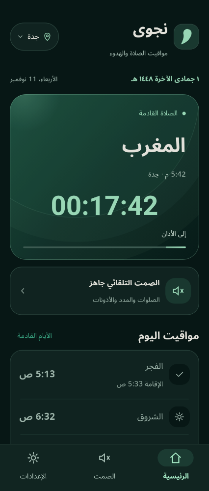
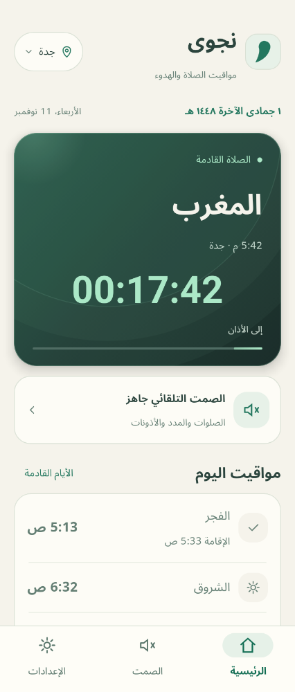
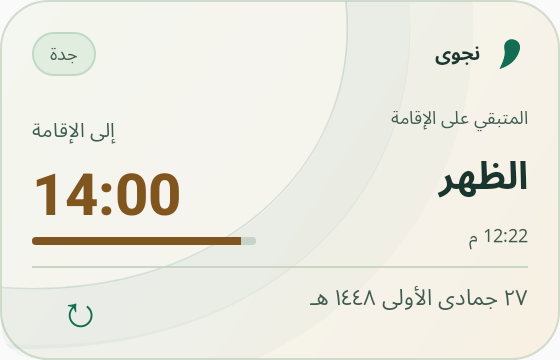
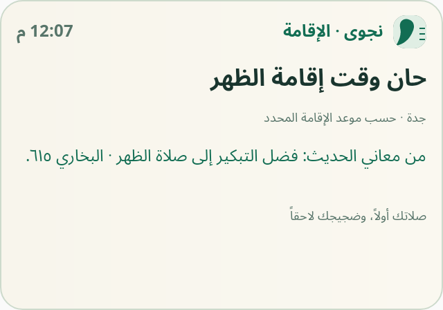

<div align="center">

# نجوى · Najwa


**صلاتك أولاً، وضجيجك لاحقاً.**  
**Prayer first. Noise can wait.**

**1.2.1 · Build 111** — Android 8.0+ · Offline · 7 languages · Apache 2.0

[تنزيل نجوى لأندرويد](https://github.com/taroq4-2/Najwa/releases/latest/download/Najwa.apk) · [الموقع العربي](https://taroq4-2.github.io/Najwa/) · [English website](https://taroq4-2.github.io/Najwa/en.html) · [الإصدارات · Releases](https://github.com/taroq4-2/Najwa/releases)

[](https://github.com/taroq4-2/Najwa/actions/workflows/android.yml) [](LICENSE)

</div>

## مواقيت واضحة وهدوء تختاره · Prayer times and quiet on your terms

<div dir="rtl">

نجوى تطبيق أندرويد مفتوح المصدر يحسب مواقيت الصلاة على جهازك. اختر أذانك وتذكيرات الإقامة لكل صلاة، وتابع الموعد القادم من الويدجت. وإذا فعّلت الصمت التلقائي، يستعيد نجوى وضع الرنين السابق عند انتهاء المدة.

</div>

Najwa is an open-source Android app that calculates prayer times offline. Set adhan and iqama alerts per prayer and see the next prayer on your home screen. Optional automatic silent mode restores your previous ringer setting after the interval.

<div dir="rtl">

هوية **مدار السكينة** تجمع الألوان الزمردية والعاجية مع واجهة واضحة وويدجت متجاوب. ابحث في أكثر من 459 ألف مكان في 246 دولة وإقليم. تتوفر العربية والإنجليزية والإندونيسية والأردية والبنغالية والهندية والتركية.

يبدأ الصمت الاختياري بعد الأذان بـ20 ثانية، وتُخصّص مدة الإقامة والصمت لكل صلاة. عند الإقامة ينتقل العداد للموعد التالي. مواقيت الإقامة تتبع إعدادك؛ راجع مسجدك للمواعيد الفعلية.

</div>

The **Madar** design pairs emerald and ivory with a clear interface and responsive widgets. Search over 459,000 places across 246 countries and territories. Arabic, English, Indonesian, Urdu, Bengali, Hindi and Turkish are supported. Optional silence starts 20 seconds after adhan; iqama and silence durations are configurable for each prayer.

## معاينة التطبيق · App preview

| الرئيسية الداكنة · Dark | الرئيسية الفاتحة · Light | English |
| :---: | :---: | :---: |
|  |  |  |

| الويدجت · Widget | الأذان · Adhan | الإقامة · Iqama |
| :---: | :---: | :---: |
|  |  |  |

معاينات مولّدة من واجهات التطبيق، وليست لقطات جهاز فعلي. تختلف حاوية الإشعارات والويدجت باختلاف الهاتف.
Previews rendered from the app UI. System notification and widget framing varies by device.

**[من أول موعد إلى أول أذان](https://taroq4-2.github.io/Najwa/#setup)** · [Setup guide in English](https://taroq4-2.github.io/Najwa/en.html#setup)

## الإصدار والتحقق · Release verification

ملف APK موقّع بالمفتاح الرسمي السابق لدعم التحديث. أكّد المستخدم نجاح تجربته. اجتازت المراجعة المحلية 184 اختبارًا، مع فحص 53 مكتبة دون تنبيهات OSV في وقت المراجعة. هذه النتائج لا تعني ضمانًا لجميع الأجهزة؛ تبقى ملاحظات التحسين والقياس موثقة في [التقرير](docs/review-release-111-ar.md).

The APK uses the established release signing key. The user confirmed a successful device trial. Local verification passed 184 tests; OSV returned no advisories for 53 resolved libraries at review time. This is not a guarantee for every device. See the [release verification guide](docs/release-verification.md).

SHA-256 · `Najwa.apk` · 1.2.1 / 111:

```text
33696188139c6e22cff627a1e3720b70988d40c432c927ccc595f5cf358eff7e
```

## البناء والمساهمة · Build and contribute

لتشغيل الاختبارات استخدم JDK 21 وAndroid SDK 36. الشفرة متاحة للتعديل وفق [Apache 2.0](LICENSE).

Run the verification suite with JDK 21 and Android SDK 36. The source is available under the [Apache 2.0 license](LICENSE).

```sh
./gradlew -PplatformTests=true :core:test :app:testDebugUnitTest :app:assembleDebug :app:lintRelease
```

Windows: use `gradlew.bat` with the same arguments. See [release verification](docs/release-verification.md) and [third-party notices](app/src/main/assets/licenses/THIRD_PARTY_NOTICES.md). To suggest a change or report a problem, [open a GitHub issue](https://github.com/taroq4-2/Najwa/issues).

[os73.com](https://os73.com/) · [contact@os73.com](mailto:contact@os73.com)

اللهم ارحم ابي
